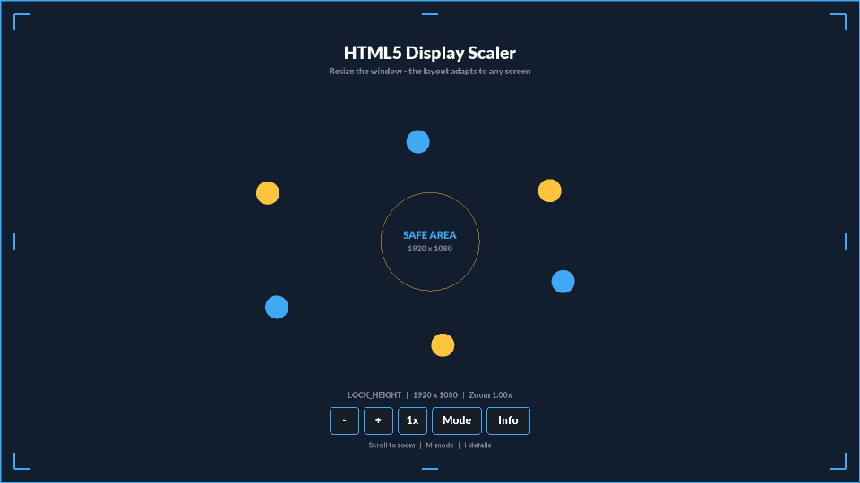
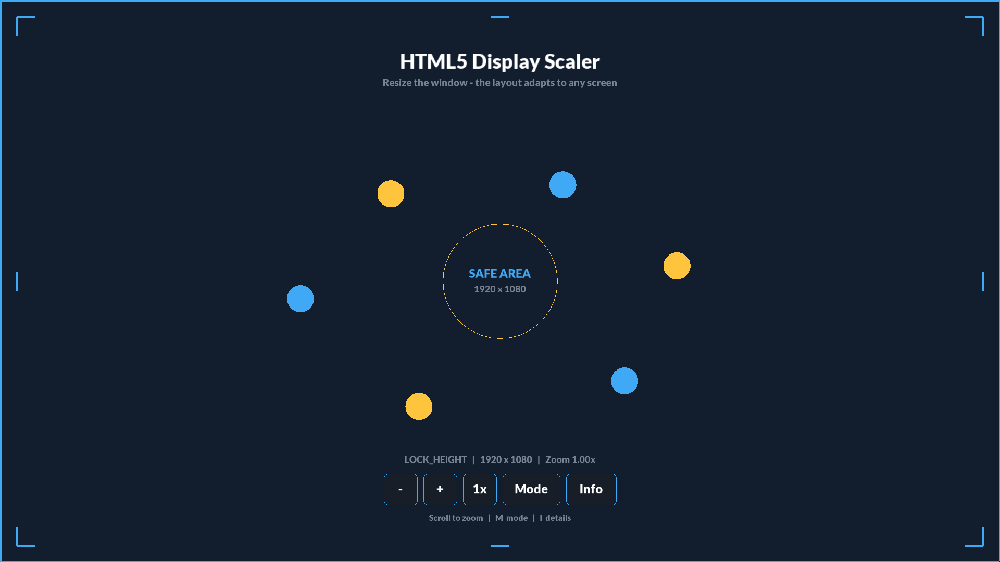
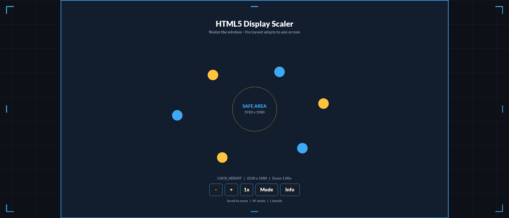
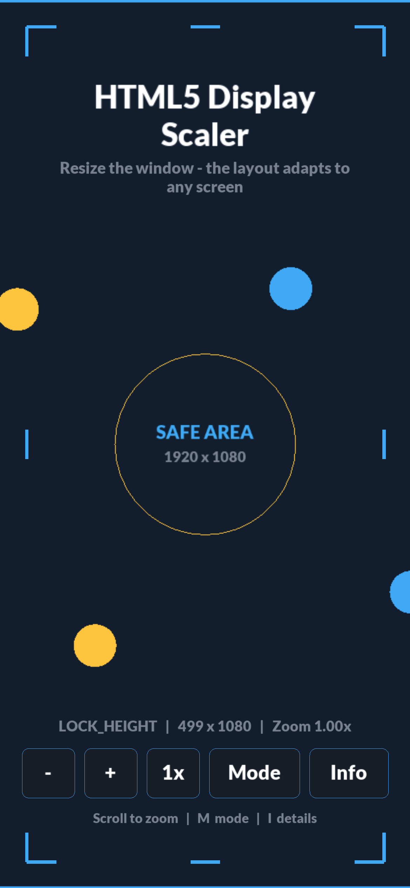
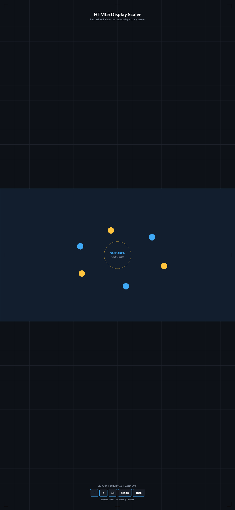
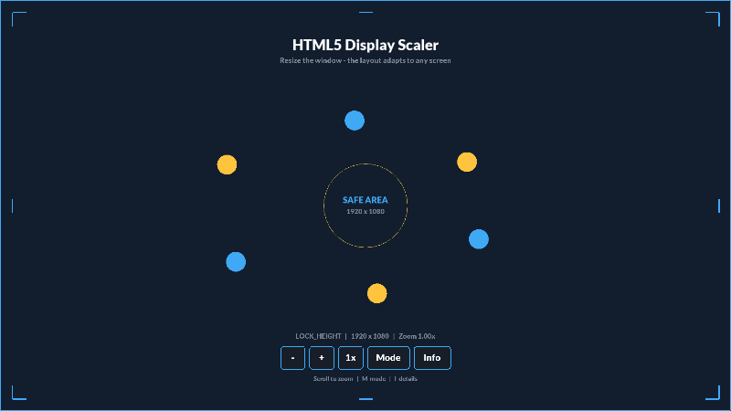

# GameMaker HTML5 Display Scaler

A drop-in display scaler for GameMaker HTML5 games. The game fills any browser window, on any aspect ratio, without stretching, letterboxing or blurring. It stays sharp on HiDPI and Retina screens, and the GUI stays pinned to the screen edges.

**[Live demo](https://dannytran-dev.github.io/gamemaker-studio-2-html-display-scaler/)**: resize the window or open it on a phone.



| 16:9 desktop | 21:9 ultra-wide |
|---|---|
|  |  |

| Phone, `LOCK_HEIGHT` | Phone, `EXPAND` |
|---|---|
|  |  |

## Quick start

1. Copy the **Display Scaler** folder into your project, leaving out **Display Scaler / Demo**. *Tools → Create Local Package* and *Import Local Package* do this in one step.
2. Set your design resolution in `scr_display_scaler_config`:
   ```gml
   #macro BASE_WIDTH 1920
   #macro BASE_HEIGHT 1080
   ```
3. Place one `oDisplayScaler` instance in your first room. It is persistent and re-applies itself on every room start.
4. Run on the HTML5 target and resize the browser.

Anchor GUI elements so they stay pinned to the screen edges:

```gml
// Draw GUI: a pause button 48px from the top-right corner on every screen
var _x = display_gui_anchor_x(BASE_WIDTH - 48, DisplayAnchor.TOPRIGHT);
var _y = display_gui_anchor_y(48, DisplayAnchor.TOPRIGHT);
draw_sprite(sPauseButton, 0, _x, _y);

// Step: GUI mouse position that is correct on HiDPI screens
if (point_in_rectangle(display_mouse_gui_x(), display_mouse_gui_y(), _x - 32, _y - 32, _x + 32, _y + 32)) { ... }
```

Tested with GameMaker IDE 2024.4.1 and runtime 2024.4.1.201.

## The problem

GameMaker's built-in HTML5 scaling options either letterbox the game or stretch it. On top of that, a plain `<canvas>` sized in CSS pixels looks soft on HiDPI and Retina screens, where `devicePixelRatio` is above 1. That covers most phones and many laptops. Games embedded in web pages also need to cope with resizes and with orientations that change at runtime.

## How it works

```
 browser resize or pixel ratio change (polled every N frames)
        │
        ▼
 oDisplayScaler.refresh()  ──► display_scaler_js_resize(cssW, cssH)       [JS extension]
                                   │  canvasW = cssW * devicePixelRatio
                                   │  canvasH = cssH * devicePixelRatio
                                   ▼
                     gmcallback_display_scaler_resize({w, h, dpr})        [GML]
                                   │  window_set_size(canvasW, canvasH)  → sharp backing store
                                   │  view size from the scale mode
                                   │  resize viewport, application_surface, GUI layer
                                   │  update camera (zoom + focus)      → emit CAMERA
                                   │                                    → emit RESIZE
                                   ▼
                     back in JS: canvas.style = cssW x cssH            → shrink to fit the page
```

### HiDPI-sharp canvas
The canvas **backing store** gets the window's size in *physical* pixels (CSS size × DPR). CSS then scales the canvas back down to the window's CSS size. This is the standard technique for crisp canvas rendering. The JS side can't resize GameMaker's internals by itself, so it calls back into GML through a script named `gmcallback_*`. GameMaker keeps that prefix unobfuscated in release builds, so JavaScript can always find the function by name.

### Scale modes
The scale mode decides which axis is locked to the base resolution; the other axis follows the screen's aspect ratio. Nothing is stretched and there are no black bars. Keep important content inside the `BASE_WIDTH × BASE_HEIGHT` safe area and let the extra *bleed* area fill in around it.

| Mode | Locked axis | Bleed |
|---|---|---|
| `DisplayScaleMode.LOCK_HEIGHT` (default) | Height | Left/right |
| `DisplayScaleMode.LOCK_WIDTH` | Width | Top/bottom |
| `DisplayScaleMode.EXPAND` | Whichever keeps the whole safe area visible | Spare axis |
| Custom function | You decide | You decide |

With the default `LOCK_HEIGHT` and a 1920×1080 base:

| Screen | Visible area |
|---|---|
| 16:9 | 1920 × 1080: exactly the safe area |
| 21:9 / ultra-wide | ~2520 × 1080: bleed on the sides |
| 4:3 | 1440 × 1080: sides cropped |
| Phone portrait | ~499 × 1080 |

Set the startup mode with `DISPLAY_SCALER_DEFAULT_MODE`, or change it at runtime with `display_scaler_set_mode()`.

### GUI scaling
The GUI layer is resized together with the view, so it always matches the visible area in game units.

- **Anchoring**: GUI positions are authored once in `BASE_WIDTH × BASE_HEIGHT` space. `display_gui_anchor_x/y()` re-anchors them to one of 9 points (corners, edges, centre), so an element authored 48px from the right edge stays 48px from the right edge on every screen.
- **HiDPI input**: GameMaker's HTML5 runner measures pointer positions in CSS pixels but maps them against the canvas's *physical* pixel size. On a DPR-2 screen that makes `device_mouse_x_to_gui()` report half the real value. The scaler stores the DPR, and `display_mouse_gui_x/y()` corrects for it.
- **World ↔ GUI**: `display_world_to_gui_x/y()` and `display_gui_to_world_x/y()` convert between the two spaces, for things like health bars over enemies.
- **Independent zoom**: `display_scaler_set_zoom()` resizes only the world camera. GUI elements keep their size and position.



### Built to be extended
The scaler doesn't call into any other system. Other systems (a GUI system, input, minimaps, UI layout) subscribe to its events instead, so they can be added or removed without touching the scaler. See [Connecting other systems](#connecting-other-systems).

On desktop targets the same manager fits the resizable game window. That path has no DPR handling and makes no JS calls.

## API

| Function | Description |
|---|---|
| `display_scaler_refresh()` | Force a re-fit |
| `display_scaler_set_mode(mode)` / `display_scaler_get_mode()` | Change or read the scale mode |
| `display_scaler_set_zoom(z)` / `display_scaler_get_zoom()` | World camera zoom |
| `display_scaler_set_focus(x, y)` | Centre the camera on a room position |
| `display_scaler_get_info()` | Snapshot of the display state (see below) |
| `display_scaler_subscribe(event, callback, [fireNow])` | Listen for `RESIZE` or `CAMERA`; returns a handle |
| `display_scaler_unsubscribe(handle)` | Stop listening |
| `display_scaler_show_overlay(bool)` | Toggle the resolution readout (hidden by default) |
| `display_gui_anchor_x(x, anchor)` / `display_gui_anchor_y(y, anchor)` | Re-anchor a BASE-space position to the current GUI |
| `display_mouse_gui_x()` / `display_mouse_gui_y()` | DPR-corrected GUI mouse position |
| `display_mouse_world_x()` / `display_mouse_world_y()` | DPR-corrected room mouse position |
| `display_world_to_gui_x/y()` / `display_gui_to_world_x/y()` | Convert between room and GUI space |

## Connecting other systems

The scaler publishes two events. Any system can listen without the scaler knowing it exists:

| Event | Fires when |
|---|---|
| `DisplayScalerEvent.RESIZE` | Canvas, view or GUI size changed (window resize, orientation change, scale mode change) |
| `DisplayScalerEvent.CAMERA` | Camera view rectangle changed (resize, zoom, focus) |

A GUI system re-laying out its elements on resize:

```gml
// oGUIManager - Create
resizeHandle_ = display_scaler_subscribe(DisplayScalerEvent.RESIZE, function(_info) {
	with (oGUIElement) {
		x = display_gui_anchor_x(xstart, anchor);
		y = display_gui_anchor_y(ystart, anchor);
	}
});

// oGUIManager - Clean Up
display_scaler_unsubscribe(resizeHandle_);
```

- **Callbacks** receive a read-only snapshot: `mode`, `modeName`, `screenWidth/Height` (CSS px), `canvasWidth/Height` (physical px), `pixelRatio`, `viewWidth/Height`, `guiWidth/Height`, `cameraX/Y/Width/Height`, `zoom` and `event`. The same struct is available any time from `display_scaler_get_info()`.
- **Late subscribers stay in sync**: by default `display_scaler_subscribe` calls the callback straight away with the current state, so a system created after the scaler doesn't wait for the next resize.
- **Order doesn't matter**: systems can subscribe before `oDisplayScaler` exists and receive the first `RESIZE` when it starts.
- **Safe with destroyed instances**: callbacks bound to an instance that doesn't exist (destroyed or deactivated) are skipped instead of crashing. A deactivated system misses events while it is inactive, so it should read `display_scaler_get_info()` when it is reactivated. Unsubscribe in Clean Up to free the listener.
- **Custom scale modes** plug in without editing the scaler:

```gml
// Always show exactly a 4:3 area
display_scaler_set_mode(function(_canvasW, _canvasH) {
	return [1440, 1080];
});
```

## Project layout

Everything lives in the **Display Scaler** folder in the GameMaker asset browser. **Display Scaler / Demo** holds an example room and can be deleted once your project has its own room.

| Resource | Purpose |
|---|---|
| `ext_display_scaler` | JS: DPR detection, CSS down-scaling, callback into GML |
| `scr_display_scaler_config` | `BASE_WIDTH/HEIGHT`, poll rate, surface scale, zoom limits, default mode, `DisplayAnchor` / `DisplayScaleMode` / `DisplayScalerEvent` enums |
| `scr_display_scaler` | Public API |
| `scr_display_scaler_events` | Event subscribe/unsubscribe |
| `gmcallback_display_scaler_resize` | JS → GML entry point |
| `oDisplayScaler` | Persistent manager: camera/view setup, resize polling, resolution overlay |
| `fntDefault` | Font for the resolution overlay (change `font_` in `oDisplayScaler` to use your own) |

To try the example, open `gamemaker-studio-2-html-display-scaler.yyp`, choose the **HTML5** target and run.

## Publishing the build

The live demo is served by GitHub Pages from the `gh-pages` branch, which holds only the HTML5 build. `main` holds only the source; local builds go in `Builds/`, which is git-ignored.

To update the demo, make an HTML5 build into `Builds/`, then copy it onto `gh-pages` through a worktree:

```bash
git worktree add ../display-scaler-pages gh-pages
cp -r Builds/. ../display-scaler-pages/
cd ../display-scaler-pages
git add -A && git commit -m "Update HTML5 build" && git push origin gh-pages
```
